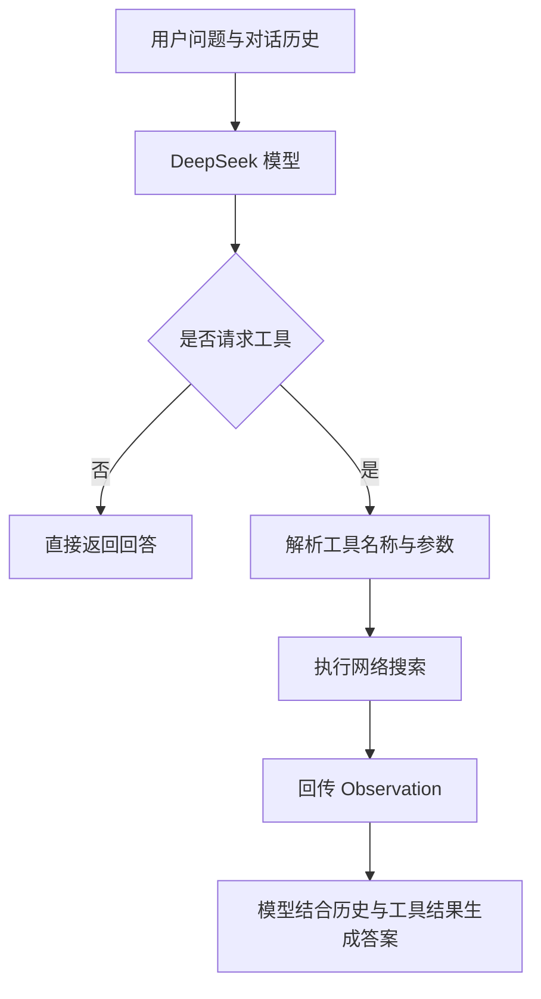

# TinyAgent —— 基于ReAct范式的AI Agent

基于 DeepSeek API 的轻量级智能体项目，使用 ReAct 风格的文本协议连接语言模型与网络搜索工具，演示普通对话、工具调用和多轮上下文关联。

## 项目简介

项目重点是理解智能体如何提出工具请求、由程序执行工具，再利用实际结果生成回答。当前实现支持一次搜索后生成答案。

## 功能

- **基础对话**：调用模型完成日常交流与知识问答。
- **工具调用**：解析 `Action` 和 `Action Input`，执行网络搜索。
- **结果回传**：将真实搜索结果作为 `Observation` 交给模型生成回答。
- **多轮上下文**：保留会话历史，支持关联前文的追问。
- **离线验证**：使用模拟模型与搜索结果验证对话流程，无需 API 密钥。

## 工作流程



`google_search` 是协议中的工具名称。实际搜索依次尝试 DDGS、Bing 和 DuckDuckGo HTML，并未接入 Google 搜索 API。

## 目录结构

```text
TinyAgent/
├── Agent.py              # 提示词、工具请求解析与对话调度
├── LLM.py                # DeepSeek API 封装与消息历史维护
├── tool.py               # 搜索工具与备用搜索方案
├── run.py                # 四组预设演示
├── test_agent_flow.py    # 离线对话流程测试
├── requirements.txt      # 项目依赖
├── .env.example          # 环境变量配置示例
├── .gitignore            # 忽略密钥、缓存等文件
└── README.md
```

## 快速开始

以下命令以 Windows PowerShell 为例。需要已安装 Python 和 Git，并能访问配置的模型接口与搜索服务。

### 1. 获取代码

```powershell
git clone https://github.com/k1-lgtm/TinyAgent-ReAct-AI-Agent.git
cd TinyAgent-ReAct-AI-Agent
```

如果已经有本地项目，直接进入项目目录即可。

### 2. 安装依赖

建议在独立的 Python 环境中安装：

```powershell
python -m venv .venv
.\.venv\Scripts\python.exe -m pip install -r requirements.txt
.\.venv\Scripts\python.exe -m pip install ddgs
```

`tool.py` 的首选搜索方案实际导入的是 `ddgs`；当前依赖文件列出的是 `duckduckgo_search`，因此需要额外安装 `ddgs`。如果首选方案不可用，程序会尝试其他搜索方式。

### 3. 配置密钥

复制配置示例：

```powershell
Copy-Item .env.example .env
```

编辑 `.env`，按以下格式填写自己的密钥：

```dotenv
DEEPSEEK_API_KEY=your_api_key_here
DEEPSEEK_BASE_URL=https://api.deepseek.com/v1
DEEPSEEK_MODEL=deepseek-chat
```

| 环境变量 | 说明 |
| --- | --- |
| `DEEPSEEK_API_KEY` | 必填，模型接口密钥 |
| `DEEPSEEK_BASE_URL` | 接口地址，默认值见上方配置 |
| `DEEPSEEK_MODEL` | 模型名称，默认值为 `deepseek-chat` |

真实密钥只保存在本地 `.env` 中，提交前确认该文件已被 `.gitignore` 忽略。模型接口调用可能产生费用，以所使用服务的账户计费为准。

### 4. 运行演示

```powershell
.\.venv\Scripts\python.exe run.py
```

如果使用已安装依赖的现有环境，也可以执行 `python run.py`。脚本会自动运行以下测试，并非交互式输入界面：

| 测试 | 问题 | 展示目标 |
| --- | --- | --- |
| 1 | 你好 | 普通对话 |
| 2 | 要求搜索北京今天的天气 | 搜索工具调用与结果回传 |
| 3 | 周杰伦是谁？ | 人物知识问答 |
| 4 | 他的第一张专辑是什么？ | 关联前文理解代词 |

测试 2 明确要求调用工具，其余问题由模型决定是否搜索。观察以下日志可判断执行进度：

| 输出标记 | 含义 |
| --- | --- |
| `Action` / `Action Input` | 模型提出的工具名称与参数 |
| `[Tool] 搜索:` | 程序已实际进入搜索工具 |
| `Observation` | 搜索工具返回的结果或失败说明 |
| `>>> 最终响应:` | 本轮返回给用户的答案 |

启动时的“API 连接成功”仅为初始化提示，不代表已完成真实接口请求。应以随后正常返回的模型回答判断接口是否可用。

## 在代码中使用

```python
from Agent import Agent

agent = Agent()
history = []

answer, history = agent.text_completion("周杰伦是谁？", history)
print(answer)

answer, history = agent.text_completion("他的第一张专辑是什么？", history)
print(answer)
```

继续对话时传入上轮返回的 `history`；开始独立会话时传入新的空列表。

## 离线测试

```powershell
.\.venv\Scripts\python.exe -m unittest test_agent_flow.py
```

测试覆盖两条关键路径：直接回答时不重复请求模型；收到搜索请求时执行工具并回传 `Observation`。测试使用模拟响应，不访问模型接口或搜索服务，因此不能代替真实联网演示。

## 实现边界与常见问题

- **工具调用次数**：当前最多执行一次搜索，然后请求模型生成答案，尚未实现连续多步工具调用循环。
- **协议解析**：使用文本标记解析工具请求，依赖模型遵循提示词格式，未使用结构化函数调用接口。
- **搜索可用性**：网络连接、搜索服务和网页结构均可能影响结果。出现搜索失败说明时，表示工具已触发，但没有取得有效资料。
- **输出可靠性**：模型回答可能出现错误，涉及事实时应结合搜索原文核对。
- **缺少依赖**：确认安装依赖和运行脚本使用的是同一个 Python 环境。
- **接口报错**：检查 `.env` 中的密钥、接口地址、模型名称以及账户权限和额度。